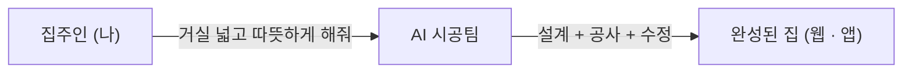
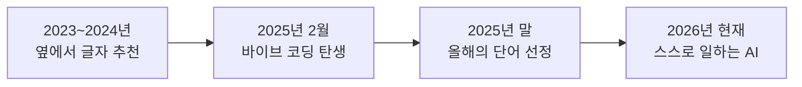
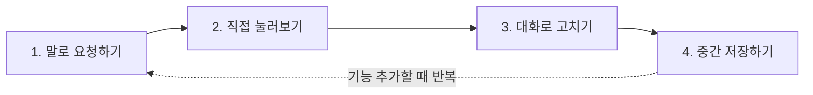
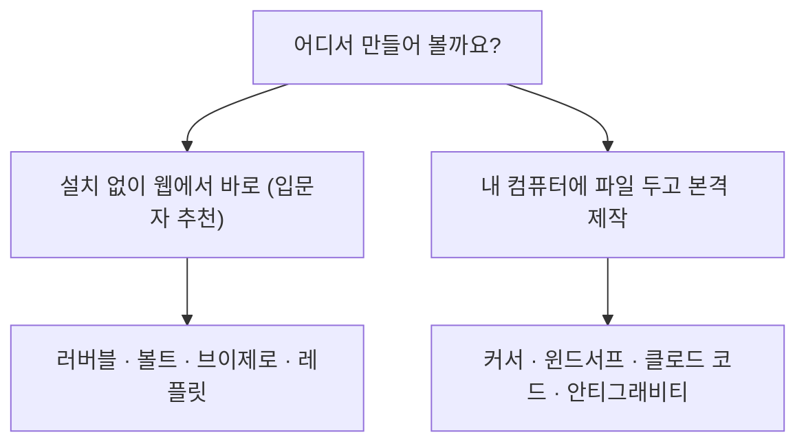
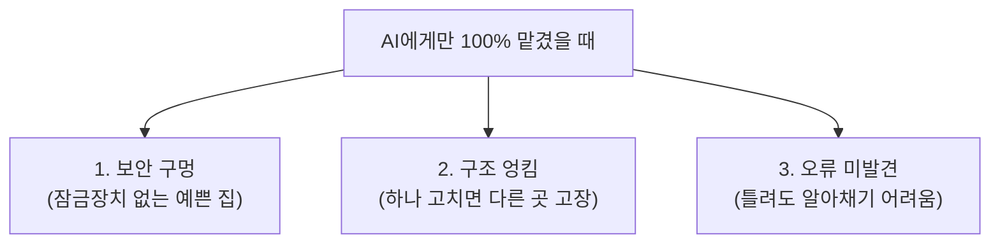
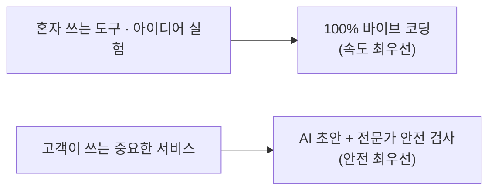
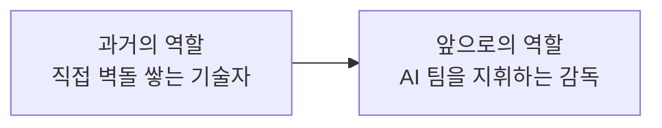

# 바이브 코딩(Vibe Coding)
### 코딩을 몰라도 말로 앱을 만드는 시대

- **대상**: 비전공자 · 입문자
- **발표자**: 시니어 AI 엔지니어

> **핵심**: 누구나 말 한마디로 나만의 앱을 만들 수 있는 새로운 시대가 열렸습니다.

---

## 오늘의 한 줄 요약

> **핵심**: 컴퓨터 언어를 외우지 않아도, 일상 말로 AI에게 시켜 프로그램을 만듭니다.

---

## 1. 바이브 코딩이란?

> **핵심**: 집주인이 원하는 느낌만 말하면, AI 시공팀이 설계부터 공사까지 대신 해줍니다.

- **예전**: 내가 직접 벽돌을 쌓고 배선을 연결해야 했습니다.
- **지금**: 나는 원하는 방향만 말하고, 실제 작업은 AI가 합니다.

---

## 2. 예전 방식과 무엇이 다른가요?

> **핵심**: '어려운 문법 암기'에서 '원하는 걸 잘 말하고 확인하는 능력'으로 바뀌었습니다.

| | 예전 방식 | 바이브 코딩 |
| :--- | :--- | :--- |
| **누가 만드나요?** | 컴퓨터 언어를 배운 전문가 | 아이디어가 있는 누구나 |
| **어떻게 만드나요?** | 어려운 명령어를 한 줄씩 입력 | 일상 대화로 시키고 고치기 |
| **얼마나 걸리나요?** | 몇 주 ~ 몇 달 | 몇 분 ~ 하루 |

---

## 3. 어떻게 발전해 왔나요?

> **핵심**: 2025년 유행으로 시작해, 2026년 현재는 AI가 스스로 일하고 사람이 감독하는 단계입니다.

- **2025년 2월**: AI 연구자 안드레 카파시가 *'느낌대로 AI에게 맡긴다'*며 처음 제안
- **2025년 말**: 비개발자도 앱을 만들기 시작하며 콜린스 사전 **'올해의 단어'** 선정
- **2026년 현재**: AI가 혼자 계획하고 시험까지 하며, 사람이 안전을 감독

---

## 4. 어떻게 하나요? (4단계 순환)

> **핵심**: 한 번에 다 시키지 말고, 작게 쪼개서 말하고 잘 될 때마다 중간 저장합니다.

- **눈에 보이게 말하기**: *"예쁘게"* 대신 *"흰 바탕에 파란 버튼으로"*라고 말합니다.

---

## 5. 어떤 도구를 쓰면 되나요?

> **핵심**: 처음엔 설치 없는 웹 도구를 쓰고, 큰 앱을 키울 땐 내 컴퓨터 도구를 씁니다.

---

## 6. 무엇을 만들 수 있나요?

> **핵심**: 거창한 서비스보다, 오늘 당장 써먹을 작은 생활·업무 도구부터 시작하세요.

- **나만의 생활 도구**: 나에게 딱 맞는 가계부, 운동 기록장, 여행 체크리스트
- **나와 가게의 웹사이트**: 작품 소개 페이지, 가게 메뉴판·예약 안내, 모임 페이지
- **귀찮은 업무 도우미**: 여러 엑셀 표 하나로 합치기, 파일 이름 한 번에 정리하기
- **간단한 놀이**: 점심 메뉴 고르기 룰렛, 퀴즈 게임
- **사업 맛보기**: 큰돈 들이기 전에 눌러볼 수 있는 시제품 만들기

---

## 7. 조심해야 할 3가지 위험

> **핵심**: AI는 겉모습은 잘 만들지만, 보안 구멍과 내부 엉킴은 스스로 못 챙깁니다.

---

## 8. 현명하게 쓰는 방법 (상황별 전략)

> **핵심**: 혼자 쓰는 실험은 100% AI에게 맡기고, 고객용 서비스는 꼭 전문가 검사를 거칩니다.

---

## 9. 앞으로 우리에게 필요한 능력

> **핵심**: 앞으로 우리는 직접 벽돌을 쌓는 기술자가 아니라, AI 팀을 지휘하는 감독입니다.

1. **문제를 짚어내는 힘**: 무엇을 만들지 정하는 능력
2. **쉽게 설명하는 힘**: AI가 헷갈리지 않게 말하는 능력
3. **결과를 확인하는 눈**: 안전하고 쓸모 있는지 판단하는 능력

---

### 감사합니다. Q&A

> **핵심**: 완벽한 준비보다, 오늘 작은 아이디어 하나를 AI에게 말로 시켜보는 것이 시작입니다.
